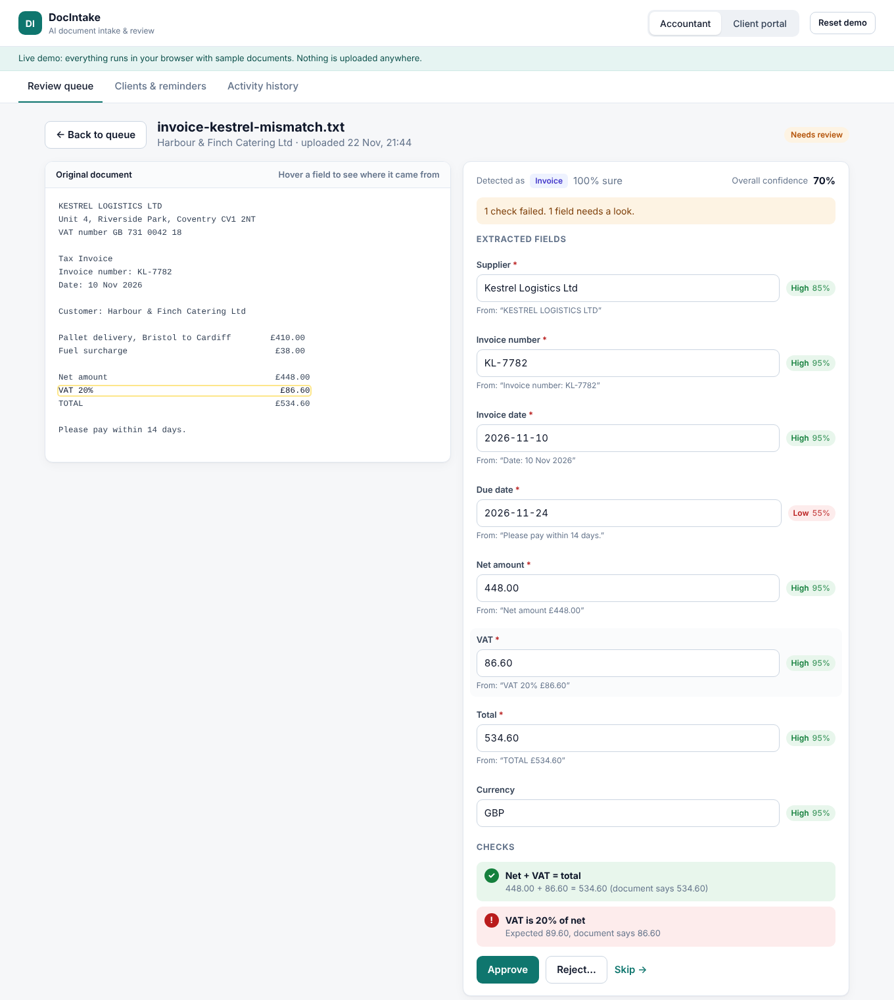
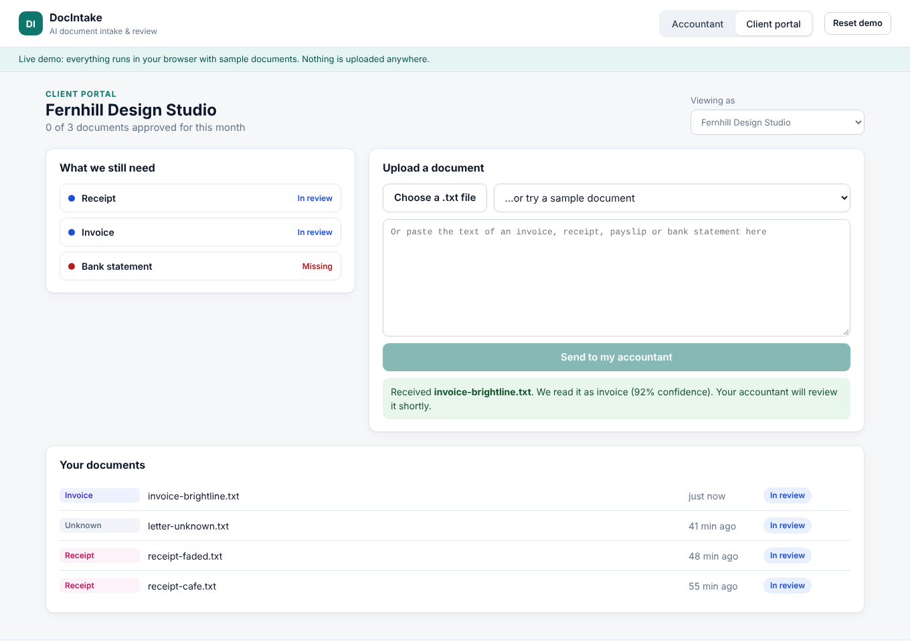
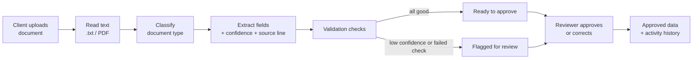

# AI Document Intake

**Turn piles of invoices, receipts, payslips and bank statements into checked, structured data, with a person approving every record.**

Clients upload their documents. The system works out what each one is, pulls out the key fields with a confidence score for each, and runs arithmetic checks. A reviewer then sees the original document next to the extracted data, fixes anything flagged and approves it. Every step is logged.

**[▶ Try the live demo](https://rajuerladinny.github.io/ai-document-intake/)**. No sign-up: it runs in your browser with sample documents.



## The problem it solves

Accounting firms, insurers, lenders and back offices still retype numbers from documents by hand. It is slow, and the mistakes are expensive. Fully automatic extraction isn't trusted either, because nobody can see why a number was read the way it was.

This project takes a human-in-the-loop approach:

- **Automate the reading, not the decision.** The system does the typing; a person approves.
- **Show the evidence.** Every field links back to the exact line it came from.
- **Flag what needs attention.** Low-confidence fields and failed checks rise to the top of the queue, so reviewers spend their time on the documents that actually need it.

## Features

| | |
|---|---|
| **Classification** | Invoice, receipt, payslip, bank statement, or unknown (with a confidence score). |
| **Field extraction** | Supplier, invoice number, dates, net, VAT, total, pay figures, balances and more. Each field has a confidence score and the source line. |
| **Validation checks** | Net + VAT = total · VAT matches the stated rate · receipt items add up · gross − deductions = net pay · bank running balances reconcile to the closing balance. |
| **Review queue** | Sorted by risk: flagged documents first, then lowest confidence. Filters for flagged, ready, approved and rejected. |
| **Side-by-side review** | Hover a field to highlight where it came from in the document. Correct a value inline; the correction is recorded with who made it. |
| **Approve / reject** | Approval is blocked while required fields are missing. A rejection needs a reason, which the client sees. |
| **Client portal** | A checklist of documents still needed this month, upload, and the status of each document. |
| **Reminders** | Preview of the reminder email for every client with missing documents. |
| **Activity history** | Every upload, extraction, correction, approval and rejection, with time and person. |
| **Privacy by default** | Extracted data keeps only the last 4 digits of bank account numbers, and account and National Insurance numbers are masked in the document viewer. |

<table>
  <tr>
    <td></td>
    <td></td>
  </tr>
  <tr>
    <td align="center"><sub>Review queue</sub></td>
    <td align="center"><sub>Client portal</sub></td>
  </tr>
</table>

## How it works



The extractor sits behind a small interface (`Extractor` in `backend/app/extraction.py`). Today it is rule-based, so it is fast, free and predictable, and its output is easy to test. Milestone 2 adds an LLM extractor behind the same interface. The confidence scores, checks, API and review screen stay the same, and the rule-based checks keep catching arithmetic errors in the LLM output.

## Tech stack

- **Frontend:** React 19, TypeScript (strict), esbuild, hand-written CSS (no UI framework), fully responsive.
- **Backend:** Python, FastAPI, SQLite (plain SQL, ready to move to PostgreSQL), pypdf for PDF text.
- **Testing:** Node's test runner for the TypeScript logic, pytest for the backend. Both extraction engines are checked against the same expected results in `samples/expected.json`, so the browser demo and the API always agree.
- **CI/CD:** GitHub Actions runs type checks, tests and the build on every push and deploys the demo to GitHub Pages.

## Project layout

```
ai-document-intake/
├── frontend/                 React review dashboard and client portal
│   ├── src/lib/extract.ts    Classification, extraction, confidence, checks
│   ├── src/lib/demoStore.ts  In-browser workflow (mirrors the backend service)
│   └── src/components/       Review queue, review screen, portal, clients, activity
├── backend/
│   ├── app/extraction.py     Same extraction rules in Python + Extractor interface
│   ├── app/service.py        Intake, correction, approval, checklist, reminders
│   ├── app/store.py          SQLite persistence
│   ├── app/main.py           FastAPI routes
│   └── tests/
├── samples/                  Sample documents + expected extraction results
└── docs/                     Roadmap and screenshots
```

## Run it locally

**Frontend demo** (Node 20+):

```bash
cd frontend
npm install
npm run dev        # http://localhost:5173
npm test           # extraction and workflow tests
npm run typecheck
```

**API** (Python 3.11+):

```bash
cd backend
python -m venv .venv && source .venv/bin/activate
pip install -r requirements-dev.txt
uvicorn app.main:app --reload     # http://localhost:8000/docs
pytest
```

The API starts with the demo clients and sample documents loaded. Set `SEED_DEMO=0` to start empty, `DATABASE_PATH=intake.db` to keep data between restarts, and `CORS_ORIGINS` to allow your frontend's URL.

### API

| Method | Path | What it does |
|---|---|---|
| `GET` | `/health` | Status and active extractor |
| `GET` / `POST` | `/clients` | List or create clients and the document types they must send |
| `GET` | `/clients/{id}/checklist` | Approved / in review / missing, per required document type |
| `GET` | `/documents?client_id=&status=` | List documents |
| `POST` | `/documents` | Upload a `.txt` or text-based `.pdf` (multipart: `client_id`, `file`) |
| `GET` | `/documents/{id}` | Document with extracted fields, confidence and checks |
| `PATCH` | `/documents/{id}/fields/{key}` | Correct a field (`{"value": "..."}`) |
| `POST` | `/documents/{id}/approve` | Approve (409 if required fields are missing) |
| `POST` | `/documents/{id}/reject` | Reject with a reason |
| `GET` | `/activity?document_id=` | Activity history |
| `GET` | `/reminders/preview` | Reminder emails that would go out today |

The `X-User` header records who made each change. Real sign-in arrives in milestone 3.

## Roadmap

| Milestone | Scope | Status |
|---|---|---|
| 1. Intake and review workflow | Extraction with confidence and checks, review dashboard, client portal, reminders preview, activity history, API, tests, live demo | ✅ Done |
| 2. Real AI extraction | LLM extractor with schema-validated JSON, OCR for photos and scans, PDF upload in the UI, PostgreSQL | Next |
| 3. Accounts and security | Sign-in and roles, per-client data isolation, EU file storage, scheduled reminder emails | Planned |
| 4. Production | Docker, deploy, monitoring, accuracy dashboard, export to CSV / Xero / QuickBooks | Planned |

Details are in [docs/ROADMAP.md](docs/ROADMAP.md).

## Current limitations

- Extraction is rule-based and tuned to UK-style documents in English. Unusual layouts get a low confidence score and go to review; they are not silently accepted.
- The browser demo reads text files and the built-in samples. The API also reads text-based PDFs; scans and photos need OCR (milestone 2).
- There is no authentication yet, so do not use it with real client data until milestone 3.

## License

MIT
